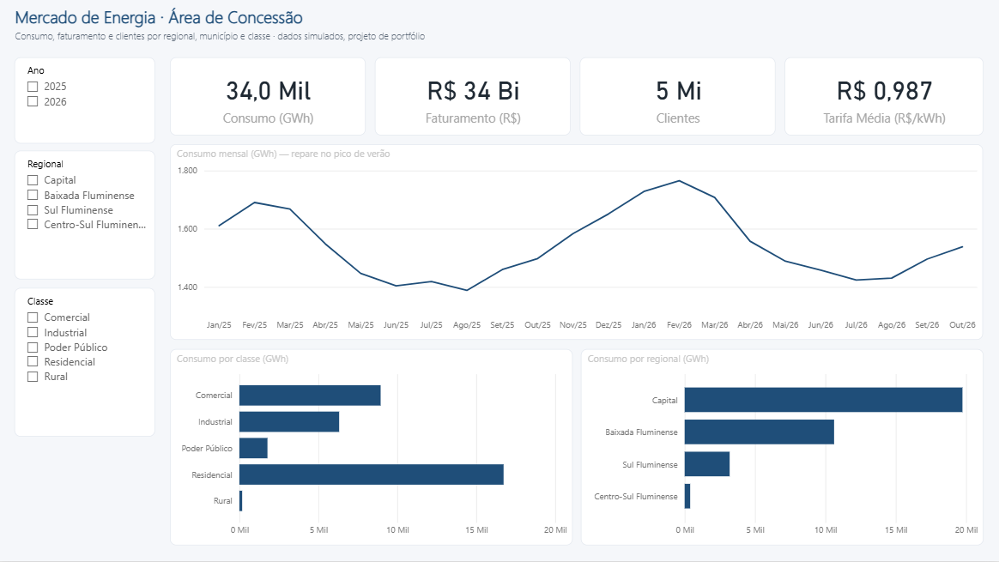
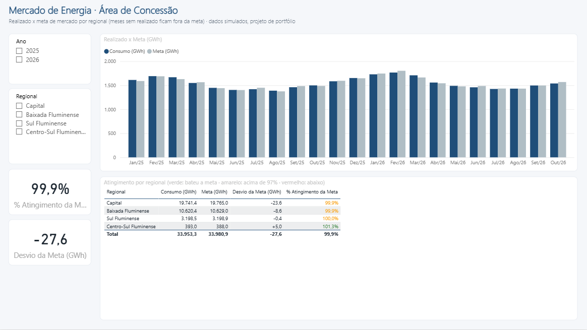
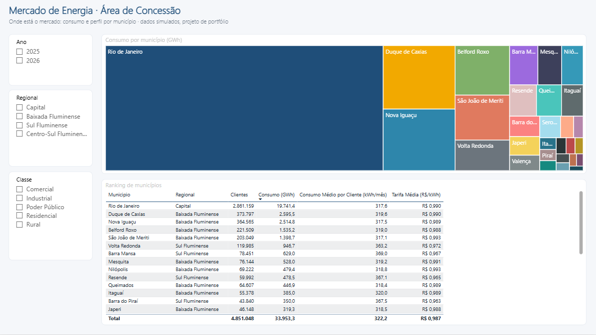

# Projeto 1 (básico) · Mercado de Energia da Área de Concessão

> **Foco técnico: Power Query.** Transformar 22 exportações mensais "sujas" de um sistema comercial em um modelo confiável de consumo, faturamento e metas por município.

*Dados 100% simulados. Projeto de portfólio independente, sem vínculo com nenhuma empresa.*



<table>
<tr>
<td width="50%"><br><sub><b>Meta x Realizado</b>: meta em cinza e atingimento colorido por regional</sub></td>
<td width="50%"><br><sub><b>Territórios</b>: peso de cada município e ranking com consumo médio e tarifa</sub></td>
</tr>
</table>

## O problema de negócio

Uma distribuidora do Rio de Janeiro atende capital, Baixada Fluminense, Sul e Centro-Sul Fluminense. Todo mês o sistema comercial exporta um CSV de faturamento por município e classe de consumo. A área de Planejamento de Mercado precisa saber:

- quanto se consumiu e faturou por regional, município e classe;
- se o mercado está acima ou abaixo da **meta** de cada regional;
- como o verão (ar-condicionado) e o reajuste tarifário mexem no consumo e na tarifa média.

O problema é que **ninguém confia na planilha**: cada mês vem com o mesmo município escrito de cinco jeitos, a classe "Residencial" aparece como `RES`, `Res.` e ` residencial`, há linhas duplicadas e um "TOTAL GERAL" no fim que dobra a soma de quem não tomar cuidado.

## O que este projeto mostra

| Problema nos dados brutos | Técnica de Power Query |
|---|---|
| 22 arquivos, um por mês | `Folder.Files` + combinar arquivos com função própria |
| 2 linhas de "relatório" antes do cabeçalho | `Table.Skip` + `Table.PromoteHeaders` |
| Linha `TOTAL GERAL` no fim | Filtro de linhas |
| `" MUN007 "`, `mun007` | Aparar (`Text.Trim`) + Maiúsculas |
| Classe escrita de 15 jeitos | **Mesclar consultas** com uma tabela de-para |
| `1.234.567,89` e `R$ 12.345,67` | Substituir valores + **Alterar tipo usando localidade (pt-BR)** |
| Competência como texto `01/2025` | Coluna personalizada com `#date()` |
| Linhas exportadas em dobro | Remover duplicatas (depois de padronizar) |
| Metas em formato largo (meses nas colunas + Total) | **Despivotar** outras colunas |
| Metas por regional × faturamento por município | Dimensão `dRegional` derivada por **referência** |
| Sem tabela de datas | Calendário gerado em M (`List.Dates`) |

## Abrir o painel pronto

1. Dê dois cliques em **`MercadoEnergia.pbip`** (Power BI Desktop recente).
2. Se os cartões aparecerem "(Em branco)", clique em **Página Inicial > Atualizar**. O Power BI não versiona os dados, só o modelo e o relatório.
3. Se os dados estiverem em outra pasta: **Transformar dados > Gerenciar parâmetros > PastaDados**.

O painel tem 3 páginas: **Visão Geral**, **Meta x Realizado** e **Territórios**, com tema próprio (`TemaEnergiaRJ`).

> O formato `.pbip` guarda o modelo (TMDL) e cada visual (JSON) em arquivos de texto, e por isso dá para ver no Git o que mudou. A primeira versão foi gerada por `criar_pbip.py`. Daqui para frente, edite direto no Power BI e salve: rodar o script de novo apaga o acabamento (ele pede `--forcar`).

Se quiser **aprender montando do zero**, ignore o `.pbip` e siga o passo a passo abaixo num relatório em branco.

## Estrutura

```
01-basico-mercado-energia-power-query/
├── MercadoEnergia.pbip         # abre o painel pronto no Power BI Desktop
├── MercadoEnergia.SemanticModel/   # modelo: consultas M, tabelas, relacionamentos, medidas (TMDL)
├── MercadoEnergia.Report/      # relatório: páginas, visuais e tema (JSON)
├── criar_pbip.py               # gerou a versão inicial do .pbip a partir de powerquery/ e dax/
├── gerar_dados.py              # recria os dados brutos (semente fixa)
├── dados/brutos/
│   ├── faturamento/            # 22 CSVs mensais (jan/2025 a out/2026)
│   ├── municipios.xlsx
│   ├── metas_regionais.xlsx
│   └── de_para_classes.csv
├── powerquery/                 # código M de cada consulta, na ordem de criação
└── dax/medidas.dax
```

Os dados já estão gerados. Para recriar: `python gerar_dados.py`.

## Passo a passo no Power BI Desktop

### 1. Consultas (Página Inicial > Transformar dados)

Para cada arquivo da pasta `powerquery/`, na ordem: **Nova Fonte > Consulta Nula > Editor Avançado**, cole o código e renomeie a consulta com o nome do arquivo (sem o número).

1. `PastaDados`: ajuste o caminho para onde está a pasta `dados\brutos` na sua máquina.
2. `DeParaClasses`: botão direito > **desmarque "Habilitar carga"** (é só auxiliar).
3. `dMunicipios`
4. `dRegional`
5. `fFaturamento`
6. `fMetas`
7. `dCalendario`

> **Dica de entrevista:** depois de colar, clique em cada etapa em "Etapas Aplicadas" e veja os dados mudando. Você precisa saber explicar *por que* cada etapa existe (está comentado no código).

**Conferência:** `fFaturamento` deve ter **3.124 linhas** e nenhuma `Classe` nula. Se aparecer nula, uma variação nova de classe não está no de-para. Esse é justamente o tipo de alerta que vale mostrar.

### 2. Modelo (Exibição de modelo)

```
dRegional (1) ──< dMunicipios (1) ──< fFaturamento >── (1) dCalendario
     (1)                                                      (1)
      └────────────────────< fMetas >──────────────────────────┘
```

| De | Para | Cardinalidade |
|---|---|---|
| `dMunicipios[Cod_Municipio]` | `fFaturamento[Cod_Municipio]` | 1:* |
| `dRegional[Regional]` | `dMunicipios[Regional]` | 1:* |
| `dRegional[Regional]` | `fMetas[Regional]` | 1:* |
| `dCalendario[Data]` | `fFaturamento[Data]` | 1:* |
| `dCalendario[Data]` | `fMetas[Data]` | 1:* |

- `dCalendario`: **Marcar como tabela de datas** (coluna `Data`). Classifique `Mes` e `Mes_Ano` por `AnoMes`.
- `dRegional[Regional]`: classifique por `Ordem`.
- `dMunicipios[Localizacao]`: Categoria de dados = **Local**.
- Oculte as colunas-chave das tabelas fato (`Cod_Municipio`, `Data`, `Regional` em `fMetas`).

### 3. Medidas

Crie uma tabela `_Medidas` (**Inserir dados > OK**) e cole as medidas de [`dax/medidas.dax`](dax/medidas.dax). São só 12. Neste projeto o DAX é coadjuvante, mas repare em duas armadilhas resolvidas:

- **`Clientes`** não pode ser somado entre meses (é estoque). A medida pega o último mês.
- **`Meta (GWh)`** ignora nov e dez/2026, que ainda não têm realizado; senão o atingimento de 2026 sai artificialmente baixo.

### 4. Páginas sugeridas

**Página 1: Visão Geral**
- Segmentações: `Ano`, `Regional`, `Classe`.
- 4 cartões: Consumo (GWh) · Faturamento (R$) · Clientes · Tarifa Média (R$/kWh).
- Linhas: Consumo (GWh) por `Mes_Ano` (o pico de verão aparece sozinho).
- Colunas empilhadas 100%: `% do Consumo Total` por `Regional` e `Classe`.

**Página 2: Meta × Realizado**
- Colunas agrupadas: Consumo × Meta por `Mes_Ano` (meta em cinza).
- Cartões: `% Atingimento da Meta` e `Desvio da Meta (GWh)`.
- Tabela por Regional com `% Atingimento da Meta` colorido por `Cor Atingimento` (formatação condicional > valor do campo).

**Página 3: Territórios**
- Treemap: Consumo por `Municipio`, onde o peso da capital salta aos olhos.
- Tabela-ranking: Município · Regional · Clientes · Consumo · Consumo Médio por Cliente · Tarifa Média.
- Extra: um mapa (Azure Maps) com `Localizacao` e o tamanho pelo Consumo. Ele depende de habilitar os visuais de mapa nas opções de segurança do Power BI, por isso ficou de fora do `.pbip`.

## Perguntas que o painel responde

1. Quanto o verão aumenta o consumo residencial em relação ao inverno?
2. O reajuste tarifário de mar/2026 aparece na tarifa média? De quanto foi?
3. Qual regional está mais abaixo da meta no ano e em quais meses?
4. Por que o Sul Fluminense tem consumo médio por cliente maior? (Dica: classe industrial.)

## Como apresentar

> "Peguei 22 exportações mensais com cabeçalho de relatório, totais embutidos, duplicatas e 15 grafias diferentes para 5 classes de consumo, e montei no Power Query um processo que roda sozinho quando chega o arquivo do mês seguinte. É só jogar o CSV na pasta e atualizar."

Para provar o "roda sozinho": apague `faturamento_2026-10.csv`, atualize (o painel vai até setembro), devolva o arquivo e atualize de novo.
