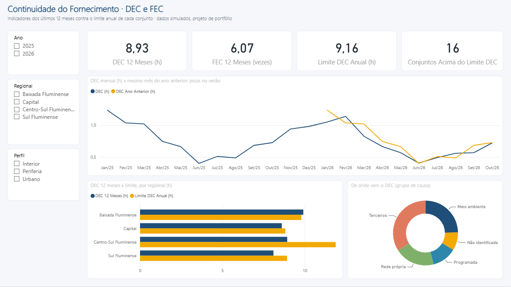
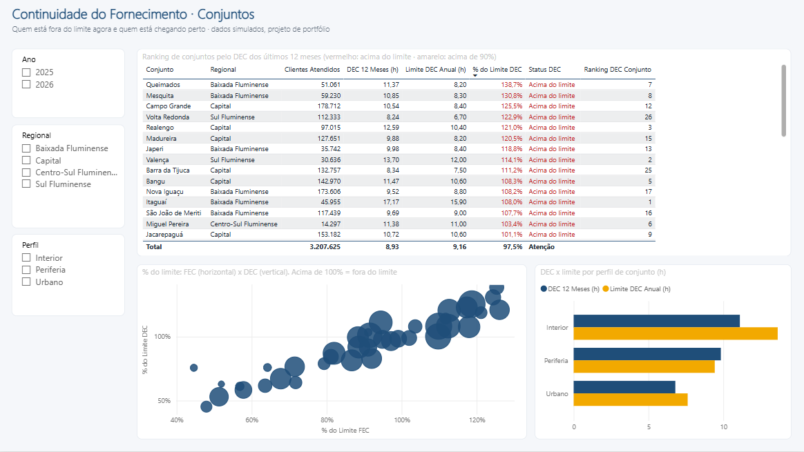
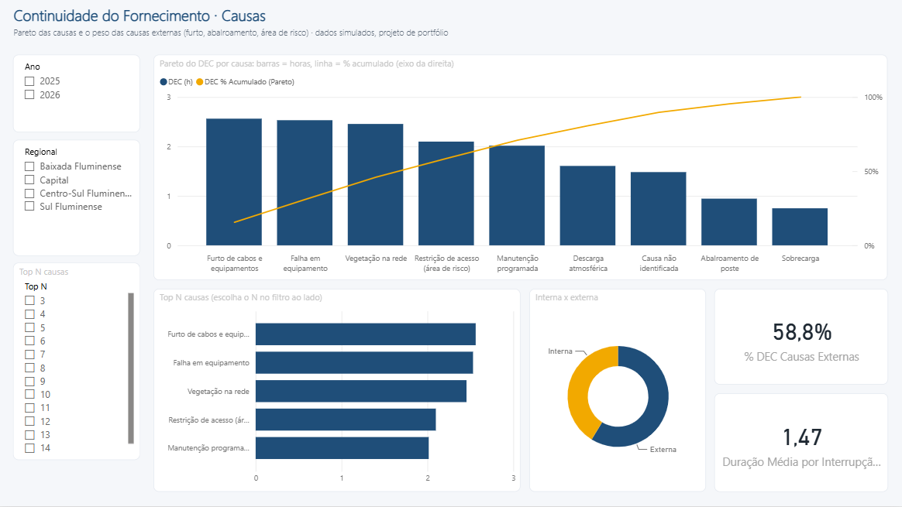
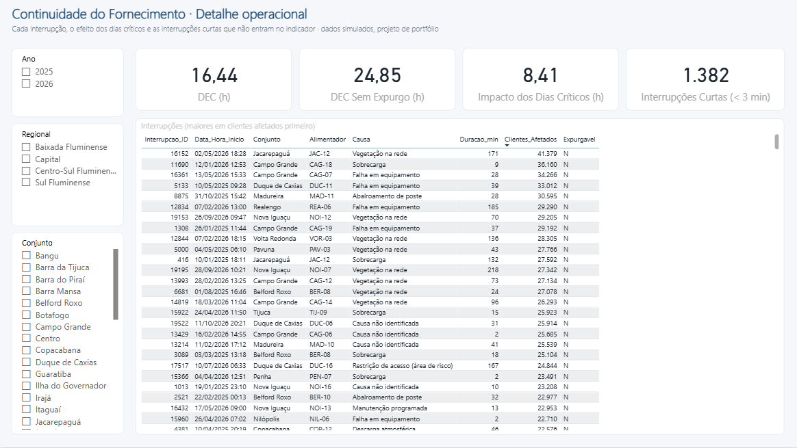

# Projeto 2 (intermediário) · Qualidade do Fornecimento: DEC e FEC

> **Foco técnico: DAX.** Calcular corretamente os indicadores de continuidade regulados pela ANEEL (DEC e FEC) por conjunto elétrico, comparar com os limites, separar o que é causa interna do que é causa externa e mostrar a tendência com inteligência de tempo.

*Dados 100% simulados. Projeto de portfólio independente, sem vínculo com nenhuma empresa. Regras simplificadas a partir do PRODIST Módulo 8.*



<table>
<tr>
<td width="50%"><br><sub><b>Conjuntos</b>: quem está fora do limite e quem está chegando perto</sub></td>
<td width="50%"><br><sub><b>Causas</b>: Pareto, Top N e o peso das causas externas (58,8%)</sub></td>
</tr>
<tr>
<td width="50%"><br><sub><b>Detalhe operacional</b>: cada interrupção e o efeito dos dias críticos</sub></td>
<td width="50%"></td>
</tr>
</table>

## Abrir o painel pronto

1. Dê dois cliques em **`ContinuidadeDecFec.pbip`** (Power BI Desktop recente).
2. Clique em **Página Inicial > Atualizar** (o Git guarda o modelo e o relatório, não os dados).
3. Se a pasta for outra: **Transformar dados > Gerenciar parâmetros > PastaDados**.

O `.pbip` foi gerado por `criar_pbip.py` a partir de `powerquery/consultas.pq` e `dax/02_medidas.dax`, usando a biblioteca `../ferramentas/pbip.py`. Para aprender montando do zero, ignore o `.pbip` e siga o passo a passo abaixo.

## O problema de negócio

Toda distribuidora tem metas anuais de continuidade definidas pela ANEEL **para cada conjunto elétrico**:

- **DEC** (Duração Equivalente de Interrupção por Unidade Consumidora): quantas horas, em média, cada cliente ficou sem energia.
- **FEC** (Frequência Equivalente de Interrupção por Unidade Consumidora): quantas vezes, em média, cada cliente ficou sem energia.

Estourar o limite significa compensação financeira aos clientes, pressão regulatória e desgaste de imagem. Na região metropolitana do Rio, parte relevante das horas interrompidas vem de causas **externas**: furto de cabos, abalroamento de postes e **restrição de acesso** das equipes a áreas de risco. A diretoria de Operações quer saber:

1. Quais conjuntos estão acima do limite **agora** (12 meses móveis)?
2. O DEC está melhorando em relação ao ano passado?
3. Quais causas explicam 80% do DEC (Pareto)? Quanto é responsabilidade de terceiros?
4. Quanto os dias críticos (temporais) teriam pesado se não fossem expurgados?

## O que este projeto mostra

| Conceito DAX | Onde aparece |
|---|---|
| `SUMX` sobre `VALUES` (cálculo mês a mês e soma) | `DEC (h)`, `FEC (vezes)`: a fórmula oficial é mensal |
| `CALCULATE` com filtros e **transição de contexto** | `CHI (h)`, `CI`, `Conjuntos Acima do Limite DEC` |
| `REMOVEFILTERS` + `VALUES` para mudar a granularidade do denominador | `Clientes Base (mês)` |
| Inteligência de tempo: `DATESINPERIOD`, `DATESYTD`, `SAMEPERIODLASTYEAR` | `DEC 12 Meses`, `DEC Acumulado no Ano`, `DEC Ano Anterior` |
| Tratamento de ano incompleto (armadilha clássica) | `DEC Ano Anterior (h)` com `CALCULATETABLE` |
| Corte "até onde há dados" ancorado na carga, e não nos eventos | `dCalendario[Tem Dados]` e `DEC 12 Meses`: fim do último mês da `fBaseClientes`, porque um fim de mês sem interrupção faria o corte recuar (sugestão recebida num comentário do LinkedIn) |
| Média **ponderada** em vez de média simples | `Limite DEC Anual (h)` |
| `RANKX` + `ALLSELECTED` | `Ranking DEC Conjunto` |
| Pareto com acumulado | `DEC % Acumulado (Pareto)` |
| `TOPN` + parâmetro What-if | `DEC Top N Causas (h)` |
| Parâmetro de campo | tabela `Indicador` (alterna DEC/FEC no mesmo visual) |
| Formatação condicional por medida | `Status DEC` + `Cor Status DEC` |
| Texto dinâmico | `Título do Painel`, `Resumo Executivo` |
| Tabela de datas em DAX | `dCalendario` com `CALENDAR` + `ADDCOLUMNS` |

## Estrutura

```
02-medio-continuidade-dec-fec-dax/
├── ContinuidadeDecFec.pbip  # abre o painel pronto (4 páginas)
├── ContinuidadeDecFec.SemanticModel/ + .Report/   # modelo (TMDL) e relatório (PBIR)
├── criar_pbip.py            # gerou o .pbip a partir de powerquery/ e dax/
├── imagens/                 # prints das 4 páginas
├── gerar_dados.py           # recria os dados (semente fixa)
├── dados/
│   ├── dConjuntos.csv       # 39 conjuntos, clientes e limites anuais
│   ├── dCausas.csv          # 9 causas (grupo, interna/externa)
│   ├── fBaseClientes.csv    # clientes por conjunto por mês (858 linhas)
│   └── fInterrupcoes.csv    # 20.013 interrupções (jan/2025 a out/2026)
├── powerquery/consultas.pq  # 5 consultas de carga (com tipos pt-BR)
└── dax/
    ├── 01_tabelas_calculadas.dax
    └── 02_medidas.dax       # ~35 medidas em 7 blocos
```

## Passo a passo no Power BI Desktop

### 1. Carga
Crie as 5 consultas de [`powerquery/consultas.pq`](powerquery/consultas.pq) (Nova Fonte > Consulta Nula > Editor Avançado) e ajuste o caminho em `PastaDados`. **Fechar e aplicar.**

### 2. Calendário e modelo
1. **Modelagem > Nova tabela** e cole o `dCalendario` de [`01_tabelas_calculadas.dax`](dax/01_tabelas_calculadas.dax).
2. **Marcar como tabela de datas** (coluna `Date`). Classifique `Mês` por `Mês Nº` e `Mês/Ano` por `AnoMes`.
3. Relacionamentos (todos 1:*, filtro em direção única):

```
dConjuntos ──< fInterrupcoes >── dCausas
    │               │
    └──< fBaseClientes      dCalendario[Date] ──< fInterrupcoes[Data]
                            dCalendario[Date] ──< fBaseClientes[Data]
```

4. Oculte as chaves nas tabelas fato.

### 3. Medidas
1. Crie a tabela `_Medidas` (**Inserir dados > OK**) e cole as medidas de [`02_medidas.dax`](dax/02_medidas.dax), **na ordem** (umas usam as outras).
2. Formatos: DEC e limites com `0,00`; FEC com `0,00`; percentuais com `%`.
3. Crie o parâmetro **Top N** (Modelagem > Novos parâmetros > Intervalo numérico: 3 a 15, padrão 5).
4. Crie o parâmetro de campo **Indicador** (Modelagem > Novos parâmetros > Campos: `DEC (h)` e `FEC (vezes)`).

### 4. Conferência
Antes de desenhar, coloque as medidas numa tabela e confira com estes valores (calculados em Python pela mesma regra):

| Filtro | DEC (h) | FEC (vezes) |
|---|---|---|
| Ano 2025 | 9,44 | 6,38 |
| Ano 2026 (jan–out) | 7,00 | 4,79 |
| `DEC Ano Anterior` com filtro 2026 | 7,52 (jan–out/2025) | 5,10 |
| `DEC 12 Meses` sem filtro (nov/25–out/26) | 8,93 | 6,07 |
| `DEC Sem Expurgo` 2025 | 14,55 | n/a |
| `Limite DEC Anual` (todos os conjuntos) | 9,16 | n/a |
| `Conjuntos Acima do Limite DEC` sem filtro | 16 de 39 | n/a |

Se `Var DEC vs Ano Anterior %` em 2026 der **−26%** em vez de **−6,9%**, você usou um `SAMEPERIODLASTYEAR` puro. Veja o comentário na medida.

### 5. Páginas sugeridas

**Página 1: Painel Executivo**
- Cartões: `DEC 12 Meses` · `FEC 12 Meses` · `Limite DEC Anual` · `Conjuntos Acima do Limite DEC`.
- Linha: o parâmetro `Indicador` por `Mês/Ano`, com `DEC Ano Anterior` como segunda linha.
- Caixa de texto com o `Resumo Executivo`.
- Segmentações: Ano, Regional, Perfil.

**Página 2: Conjuntos**
- Matriz: Conjunto · DEC 12M · Limite · % do Limite · Status · Ranking, com cor de fundo por `Cor Status DEC`.
- Dispersão: X = `% do Limite FEC`, Y = `% do Limite DEC`, tamanho = `Clientes Atendidos`. O quadrante superior direito são os conjuntos críticos nos dois indicadores.
- Mapa por `Localizacao`.

**Página 3: Causas**
- Colunas + linha (Pareto): `DEC (h)` por Causa + `DEC % Acumulado (Pareto)`.
- Barras com `DEC Top N Causas` e segmentação do parâmetro Top N.
- Rosca: DEC por `Responsabilidade` (Interna × Externa).
- Matriz Regional × Grupo de causa.

**Página 4: Detalhe operacional** (drill-through a partir do conjunto)
- Tabela de interrupções: início, alimentador, causa, duração, clientes afetados, CHI.
- Cartões: `Impacto dos Dias Críticos`, `Interrupções Curtas (< 3 min)`, `% DEC Programado`.

## Perguntas que o painel responde

1. Quais conjuntos estouram DEC **e** FEC ao mesmo tempo? Onde está a maior folga?
2. Em Madureira, Belford Roxo e Santa Cruz, quanto do DEC vem de causas externas?
3. O verão (dez–mar) concentra quanto do DEC anual? Quais causas puxam esse pico?
4. A melhora de 2026 é geral ou concentrada em algumas regionais?

## Resumo

> "Modelei os indicadores de continuidade como a regra regulatória pede: cálculo mensal, interrupções acima de 3 minutos e expurgo de dias críticos. A parte difícil do DAX foi o denominador: o DEC por causa precisa manter o total de clientes do conjunto, e a comparação com o ano anterior precisa ignorar os meses que ainda não aconteceram. Deixei uma tabela de conferência que bate com um cálculo independente em Python."
