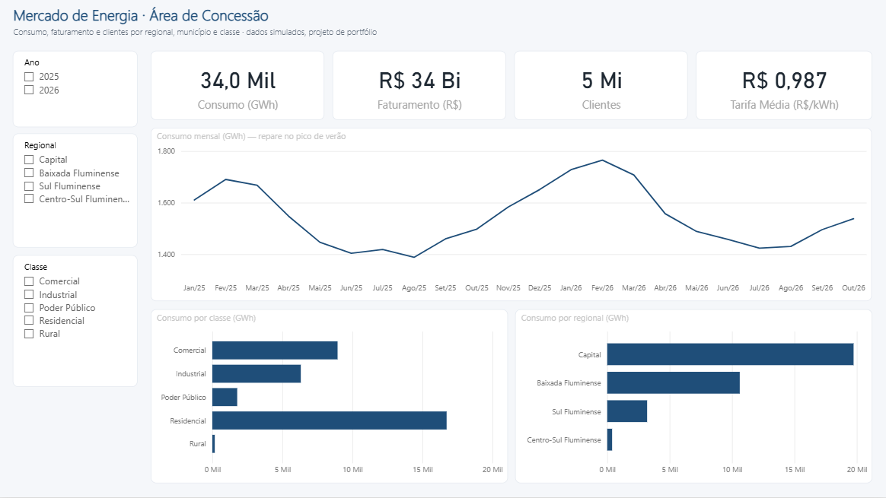

# Portfólio Power BI · Distribuição de Energia

Três projetos com tema de **distribuidora de energia no Rio de Janeiro**, em ordem crescente de dificuldade. Cada um aprofunda uma ferramenta diferente:

| # | Projeto | Nível | Foco técnico | Pergunta de negócio |
|---|---|---|---|---|
| 1 | [Mercado de Energia da Área de Concessão](01-basico-mercado-energia-power-query/) | Básico | **Power Query** | Quanto consumimos e faturamos por município e classe? Estamos na meta? |
| 2 | [Qualidade do Fornecimento: DEC e FEC](02-medio-continuidade-dec-fec-dax/) | Intermediário | **DAX** | Quais conjuntos estouram os limites da ANEEL e por quê? |
| 3 | [Radar de Perdas Não Técnicas](03-avancado-radar-perdas-python-sql/) | Avançado | **Python + SQL Server + Power BI** | Onde está a energia que entra na rede e não é faturada, e quem inspecionar primeiro? |

Projeto 1 pronto (abra o `MercadoEnergia.pbip` no Power BI Desktop). Os projetos 2 e 3 estão em construção.

Os três temas são escolhidos a dedo: **mercado e faturamento**, **continuidade do fornecimento (DEC/FEC)** e **perdas não técnicas** estão entre os assuntos centrais de qualquer distribuidora regulada pela ANEEL. Na área de concessão do Rio, perdas e restrição de acesso a áreas de risco têm peso especial.

> **Aviso:** todos os dados são **simulados** por scripts Python com semente fixa (reprodutíveis). Nomes de bairros e municípios dão contexto realista, mas nenhum número representa uma empresa real. Projeto independente, sem vínculo com nenhuma distribuidora. Não use logotipos ou identidade visual de empresas reais nos painéis.

## Pré-requisitos

- Power BI Desktop
- Python 3.11+ com `pip install -r requirements.txt`
- Projeto 3: SQL Server (Developer/Express) local com autenticação do Windows e ODBC Driver 17 ou 18

## Ordem sugerida

1. **Projeto 1** (1 a 2 dias): aprenda a tratar dados "como vêm da vida real". Cada etapa do código M está comentada.
2. **Projeto 2** (2 a 4 dias): modelo estrela + ~35 medidas DAX. Há uma tabela de conferência com os valores esperados.
3. **Projeto 3** (1 semana): pipeline automatizado de ponta a ponta. É o que mais impressiona, porque mostra engenharia de dados, regra de negócio e visualização juntas.

## Como publicar no portfólio

- **GitHub**: um repositório com esta pasta. Inclua prints de cada página do painel numa pasta `imagens/` e cite-os no README de cada projeto. O `.pbix` pode ir junto (os projetos 1 e 2 são pequenos).
- **LinkedIn**: um post por projeto, com 2 ou 3 prints e o problema de negócio na primeira linha (não a ferramenta). Exemplo: "Metade dos conjuntos elétricos estourou o limite de DEC. Montei um painel que mostra por quê."
- **Entrevista**: cada README termina com um parágrafo "Como apresentar". Treine falar o problema → o que fez → o resultado em 1 minuto.

## Paleta sugerida (neutra)

| Uso | Cor |
|---|---|
| Principal | `#1F4E79` |
| Destaque | `#F2A900` |
| Bom / dentro do limite | `#2E7D32` |
| Atenção | `#F9A825` |
| Crítico / acima do limite | `#C62828` |
| Fundo | `#F5F7FA` |
